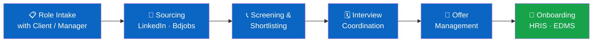
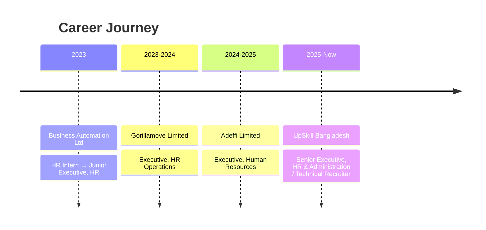

<!-- HEADER BANNER -->

  

<!-- TYPING ANIMATION -->

  

  
  
  
  

  
  
  
  
  
  

---

## 👨‍💼 About Me

HR professional with **3+ years of experience** in talent acquisition, payroll management, and HR compliance, with a focus on **IT hiring for Bangladesh and U.S.-based roles**. I run end-to-end recruitment for Developers, QA, and DevOps positions, and I'm used to managing **HR, administration, and procurement independently**.

I'm comfortable with **HRIS, EDMS, and ERP** systems and know the **Bangladesh Labour Act 2006** and **Bangladesh Labour Rules 2015**.

| | |
|---|---|
| 📍 **Based in** | Dhaka, Bangladesh |
| 🟢 **Currently** | Senior Executive, HR & Administration / Technical Recruiter @ UpSkill Bangladesh |
| 🔭 **Looking for** | Senior HR & Technical Recruitment roles |
| 🌍 **Hiring for** | Bangladesh + U.S.-based clients |
| 🏭 **Sectors** | IT, advertising, logistics |
| 🗣️ **Ask me about** | Tech hiring, high-volume recruitment, payroll, labour-law compliance, HRIS setup |

---

## 📊 Impact Snapshot

| 🎤 Interviews Conducted | 🛵 Riders Onboarded | 👔 Executive & Manager Hires | 🏢 Organizations | 🏭 Sectors |
|:---:|:---:|:---:|:---:|:---:|
| **650+** | **300+** | **200+** | **4** | **3** |

Interviews, rider onboarding, and executive, senior executive and manager-level hires achieved at Gorillamove (Dec 2023 – Oct 2024).

---

## 🎯 What I Do

<table>
  <tr>
    <td width="33%" valign="top">
      <h3>🔎 Technical Recruitment</h3>
      End-to-end hiring: sourcing via LinkedIn and Bdjobs, screening, interview coordination, offers, onboarding.
    </td>
    <td width="33%" valign="top">
      <h3>🌍 Global Talent Acquisition</h3>
      Defining role requirements and timelines with U.S. clients, and building relationships with local partners for smooth placements.
    </td>
    <td width="33%" valign="top">
      <h3>💰 Payroll Management</h3>
      Monthly payroll processing, including payment calculations for a delivery rider fleet.
    </td>
  </tr>
  <tr>
    <td width="33%" valign="top">
      <h3>⚖️ Compliance & Audits</h3>
      Statutory compliance, policy implementation, compliance audits, and warehouse audits to find operational bottlenecks.
    </td>
    <td width="33%" valign="top">
      <h3>🗂️ HR Operations</h3>
      Attendance, leave management, employee records, and HRIS/EDMS administration.
    </td>
    <td width="33%" valign="top">
      <h3>🏢 Admin & Procurement</h3>
      Office administration, vendor management, and procurement, handled independently across organizations.
    </td>
  </tr>
</table>

---

## 🧑‍💻 Roles I've Hired

---

## 🔄 My Hiring Pipeline

---

## 🛠️ Skills & Tools

**Talent Acquisition**

**HR Operations**

**Payroll & Compliance**

**HR Tech & Systems**

---

## 💼 Experience

<b>🔹 Senior Executive, HR & Administration / Technical Recruiter · UpSkill Bangladesh</b> <i>(Sep 2025 – Present)</i>

 

- Sole HR representative managing end-to-end recruitment for local and U.S.-based technical roles
- Hired AI/ML Engineers, AI Software Developers, Full Stack Developers, Webflow Developers, Trainers for Academia, Video Editors, SEO Executives, and AI Visual roles
- Sourced and screened candidates through LinkedIn and Bdjobs; coordinated interviews, offers, and onboarding
- Worked with U.S. clients and hiring managers to define role requirements and hiring timelines
- Ran all Bangladesh HR functions: attendance, leave management, policy implementation
- Handled administration and procurement for Bangladesh operations
- Conducted outbound calling and follow-up for training enrollment to support business growth

<b>🔹 Executive, Human Resources · Adeffi Limited</b> <i>(Oct 2024 – Sep 2025)</i>

 

- Led recruitment and talent management for the advertising sector
- Processed monthly payroll in line with legal and regulatory requirements
- Maintained employee records and HR documentation per Bangladesh labour regulations
- Administered HRIS and EDMS software to improve data accuracy and accessibility
- Handled administration and procurement

<b>🔹 Executive, HR Operations · Gorillamove Limited</b> <i>(Dec 2023 – Oct 2024)</i>

 

- Scaled the workforce during rapid growth: **650+ interviews, 300+ delivery riders onboarded, 200+ executive, senior executive and manager-level hires**
- Coordinated high-volume interview scheduling and onboarding to support fleet expansion
- Managed payroll and payment calculations for the delivery rider fleet
- Conducted warehouse audits to identify bottlenecks and improve operational efficiency
- Handled administration and procurement

<b>🔹 HR Intern → Junior Executive, HR · Business Automation Ltd</b> <i>(Jan 2023 – Nov 2023)</i>

 

- Supported HR in an IT company dealing with high attrition and remote-work policy challenges
- Assisted with recruitment coordination, interview scheduling, and employee
