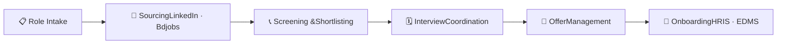
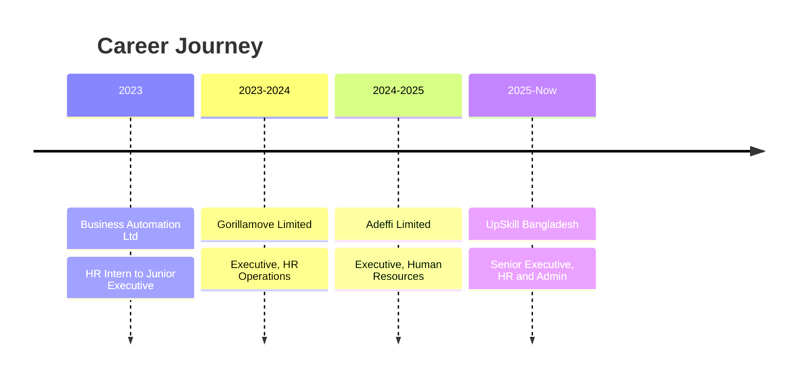

Preview approximation. Badges, banner and animation are redrawn here because external image services can’t load in a published page. On GitHub they render from the real services.

# Zahid Bin Ali

HR & Admin Professional | Technical Recruiter | HR Operations

## 👨‍💼 About Me

HR professional with **3+ years of experience** in talent acquisition, payroll management, and HR compliance, with a focus on **IT hiring for Bangladesh and U.S.-based roles**. I run end-to-end recruitment for Developers, QA, and DevOps positions, and I’m used to managing **HR, administration, and procurement independently**.

I’m comfortable with **HRIS, EDMS, and ERP** systems and know the **Bangladesh Labour Act 2006** and **Bangladesh Labour Rules 2015**.

| 📍 **Based in** | Dhaka, Bangladesh |
| --- | --- |
| 🟢 **Currently** | Senior Executive, HR & Administration / Technical Recruiter @ UpSkill Bangladesh |
| 🔭 **Looking for** | Senior HR & Technical Recruitment roles |
| 🌍 **Hiring for** | Bangladesh + U.S.-based clients |
| 🏭 **Sectors** | IT, advertising, logistics |
| 🗣️ **Ask me about** | Tech hiring, high-volume recruitment, payroll, labour-law compliance, HRIS setup |

## 📊 Impact Snapshot

| 🎤 Interviews | 🛵 Riders Onboarded | 👔 Executive & Manager Hires | 🏢 Organizations | 🏭 Sectors |
| --- | --- | --- | --- | --- |
| 650+ | 300+ | 200+ | 4 | 3 |

Interviews, rider onboarding, and executive, senior executive and manager-level hires achieved at Gorillamove (Dec 2023 – Oct 2024).

## 🎯 What I Do

### 🔎 Technical Recruitment

End-to-end hiring: sourcing via LinkedIn and Bdjobs, screening, interview coordination, offers, onboarding.

### 🌍 Global Talent Acquisition

Defining role requirements and timelines with U.S. clients, and building relationships with local partners.

### 💰 Payroll Management

Monthly payroll processing, including payment calculations for a delivery rider fleet.

### ⚖️ Compliance & Audits

Statutory compliance, policy implementation, compliance audits, and warehouse audits.

### 🗂️ HR Operations

Attendance, leave management, employee records, and HRIS/EDMS administration.

### 🏢 Admin & Procurement

Office administration, vendor management, and procurement, handled independently.

## 🧑‍💻 Roles I’ve Hired

## 🔄 My Hiring Pipeline

## 🛠️ Skills & Tools

## 💼 Experience

**🔹 Senior Executive, HR & Administration / Technical Recruiter · UpSkill Bangladesh** *(Sep 2025 – Present)*

- Sole HR representative managing end-to-end recruitment for local and U.S.-based technical roles
- Hired AI/ML Engineers, AI Software Developers, Full Stack and Webflow Developers, Trainers for Academia, Video Editors, SEO Executives, and AI Visual roles
- Sourced and screened candidates through LinkedIn and Bdjobs; coordinated interviews, offers, and onboarding
- Worked with U.S. clients and hiring managers to define role requirements and timelines
- Ran all Bangladesh HR functions plus administration and procurement
- Conducted outbound calling and follow-up for training enrollment

**🔹 Executive, Human Resources · Adeffi Limited** *(Oct 2024 – Sep 2025)*

- Led recruitment and talent management for the advertising sector
- Processed monthly payroll in line with legal and regulatory requirements
- Maintained employee records per Bangladesh labour regulations
- Administered HRIS and EDMS software; handled administration and procurement

**🔹 Executive, HR Operations · Gorillamove Limited** *(Dec 2023 – Oct 2024)*

- Scaled the workforce: **650+ interviews, 300+ riders onboarded, 200+ executive, senior executive and manager-level hires**
- Coordinated high-volume interview scheduling and onboarding for fleet expansion
- Managed payroll and payment calculations for the rider fleet
- Conducted warehouse audits to find bottlenecks; handled administration and procurement

**🔹 HR Intern → Junior Executive, HR · Business Automation Ltd** *(Jan 2023 – Nov 2023)*

- Supported HR in an IT company facing high attrition and remote-work policy challenges
- Assisted with recruitment coordination, interview scheduling, and documentation
- Streamlined onboarding for new technical hires

## 🎓 Education

- 🎓 **BBA in Human Resources Management**, Southeast University (2019 – 2023)
- 🏫 **HSC (Business Studies)**, BAF Shaheen College, Chattogram (2018)

## 🤝 Let’s Connect

I’m always happy to talk about technical hiring, HR operations, and compliance in Bangladesh’s IT sector. Hiring a developer, or looking for your next role? Reach out.
